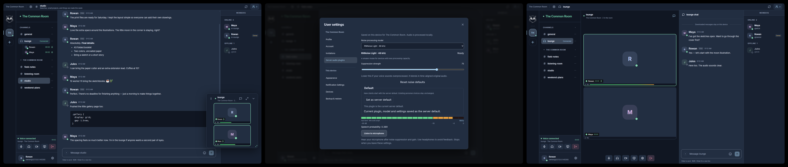

<table align="center" border="0" cellspacing="0" cellpadding="0">
  <tr>
    <td align="center" valign="middle">
      
    </td>
    <td align="left" valign="middle">
      <h1 align="left">Haunt</h1>
    </td>
  </tr>
</table>
This repository contains Haunt's central documentation, Compose configuration,
screenshots, coordinated releases, and pinned server, client, and audio-plugin
components. Haunt is self-hosted community chat with channels, direct messages,
voice/video calls, profiles, permissions, and moderation. Accounts and data belong
to the independently operated server where they were created.

The project is under active development. It does not implement every Discord
feature and has not received an independent security audit.



## Choose a starting point

| What you want | Where to go |
| --- | --- |
| Run the guided installer | `python3 install.py` · [installation guide](docs/installation.md) |
| Run a server in one container manually | [Container and credentials guide](docs/installation.md) |
| Build a server with the web client embedded | [Server build guide](docs/server/index.md) |
| Build a desktop or separately hosted web client | [Client build guide](docs/client/index.md) |
| Create a noise-suppression plugin | [Plugin developer map](docs/audio-plugins.md) |
| See the interface | [Demo gallery](docs/gallery.md) |
| Download the desktop client | [Central downloads](https://github.com/example-git/haunt/releases/latest) |
| Find coordinated releases | [Hub releases](https://github.com/example-git/haunt/releases) |
| Browse all documentation | [Documentation index](docs/index.md) |
| Run Haunt Nexus: optional encrypted sync, Cloudflare Tunnel and signed updates | [Sync service and trust boundaries](https://github.com/example-git/haunt-sync) |
| Understand release publishing | [Release layout](docs/releases.md) |

For the prebuilt server container, client traffic goes to bundled Nginx on
container TCP 80/443, mapped to host TCP 80/443 by default. Those host ports are
configurable; the supplied Compose file keeps the internal `127.0.0.1:8080`
Haunt backend unpublished. See the [installation guide](docs/installation.md).

A release appears only when its artifacts have actually been prepared. A source
checkout is not an installer; use the public release page for packaged downloads.

## Independent components, pinned together

| Checkout | Repository | Responsibility |
| --- | --- | --- |
| `server/` | [haunt-server](https://github.com/example-git/haunt-server) | Go API, accounts, storage, media relay, embedded web client and container runtime |
| `client/` | [haunt-client](https://github.com/example-git/haunt-client) | Browser UI, desktop shell, reusable client libraries |
| `audio-plugins/rnnoise/` | [haunt-audio-rnnoise](https://github.com/example-git/haunt-audio-rnnoise) | Redistributable bundled audio plugin and adapter example |
| `sync/` | [haunt-sync](https://github.com/example-git/haunt-sync) | Optional encrypted settings and saved-sign-in synchronization service |

All four are Git submodules pinned to reviewed commits. Source and component tests
stay in their repositories. This hub repository records combinations that belong
together and is the intended home for combined downloads and container images.
The server retains its own `client/` submodule so it remains buildable independently.
The top-level client and `server/client` must point to the same commit; they are two
checkouts of one repository, not independent clients.

```sh
git clone --recurse-submodules https://github.com/example-git/haunt.git
cd haunt
python3 scripts/check-pins.py
```

Build the complete server with `cd server && scripts/build-server.sh`, or use the published image with the
[central installation guide](docs/installation.md). Work on the client in `client/`; after a
client release/version commit, update both client pins deliberately before updating
the hub. Do not use `git submodule update --remote` as a release procedure.

RNNoise ships as the default on fresh servers. Plugins process microphone audio
locally through a restricted Wasm interface. Server operators can add compatible
plugins; private operator packages are never part of this source tree or images.

Server-hosted integrations are a separate **Server extensions** category, with
owner-only setup and live testing. See the [extension projects](extensions/README.md)
and [server extension guide](server/docs/server-extensions.md). The TikTok TTS
provider source is pinned as a separate Git submodule under
`extensions/tiktok-tts-plugin`.

## Trust and recovery

Accounts use `username@server-address` and belong to that service. Servers do not
federate identities or messages. DMs support client-side encryption; server channels
and relayed media have different trust boundaries. HTTPS, backups, account security
and operator maintenance still matter. Read the component security and recovery
documentation before deploying a community.

Haunt is independent of Discord. Product names describe familiar behavior, not an
affiliation. The component repositories are public and independently buildable;
coordinated downloads and containers live here, while existing users' update
sources remain compatible.

## License and participation

Haunt-owned code in this repository is available under the
[BSD 3-Clause License](LICENSE). Submodules and third-party content retain their
own licenses and notices. See [CONTRIBUTING.md](CONTRIBUTING.md) before submitting
changes and [SECURITY.md](SECURITY.md) for private vulnerability reports.
