# Haunt demo gallery

Actual browser captures from an isolated local server, using fictional accounts and messages.
The voice view shows two local test clients connected through the service.
Native Windows Mica and macOS vibrancy are not simulated in these images.

## Charcoal theme with community chat and members

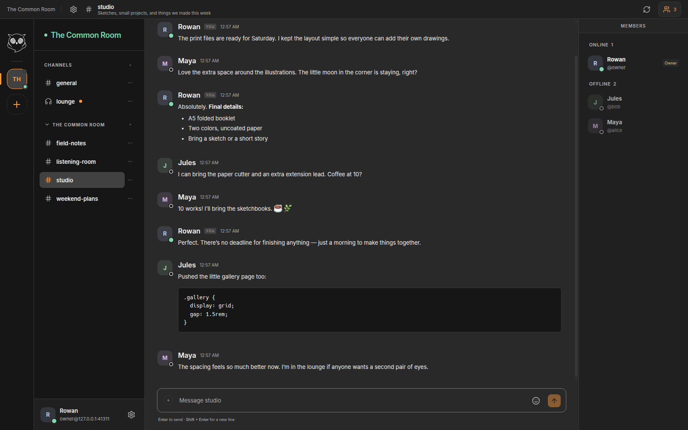

## Theme presets and custom color controls

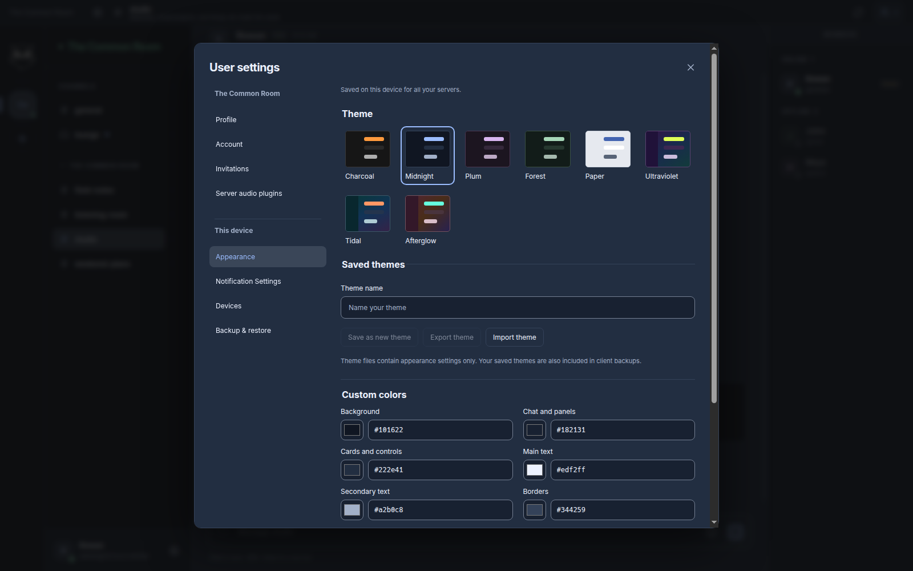

## Midnight theme with community chat and members

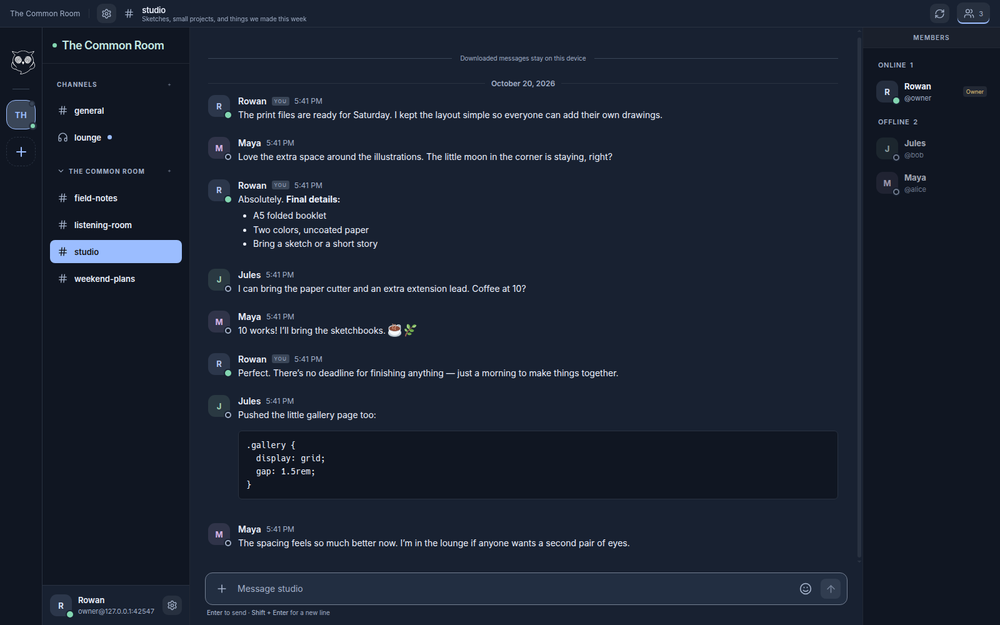

## Plum theme with community chat and members

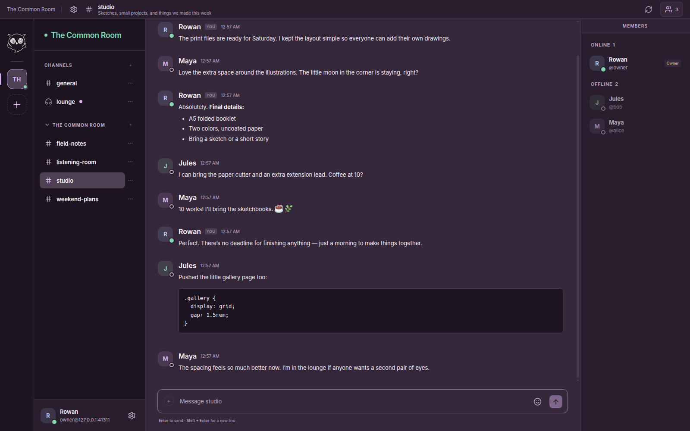

## Forest theme with community chat and members

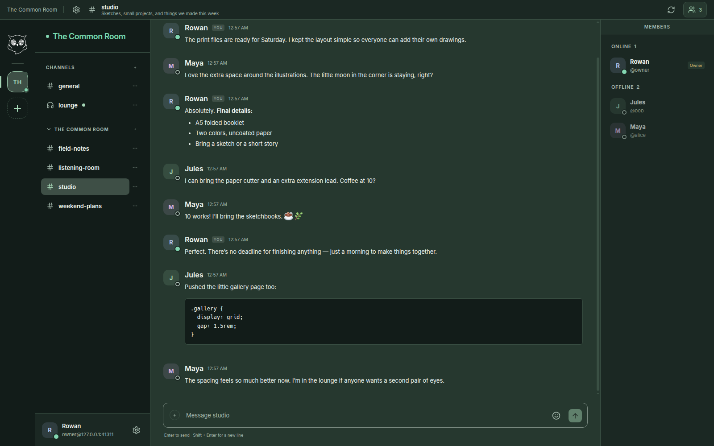

## Paper theme with community chat and members

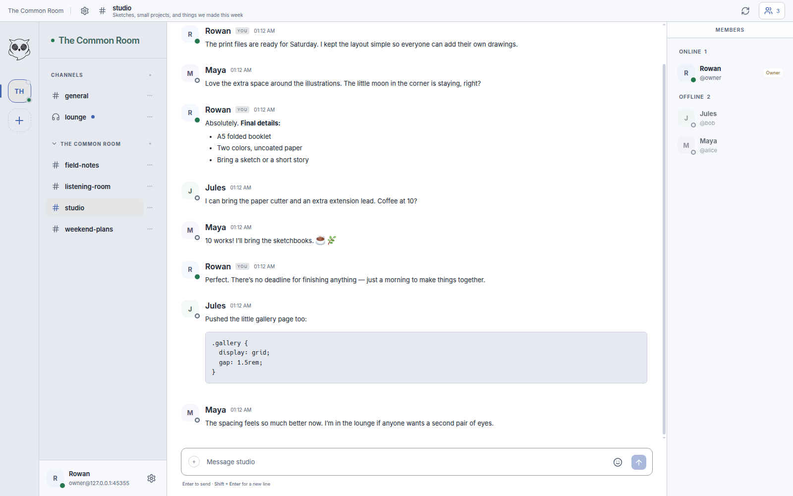

## Ultraviolet theme with community chat and members

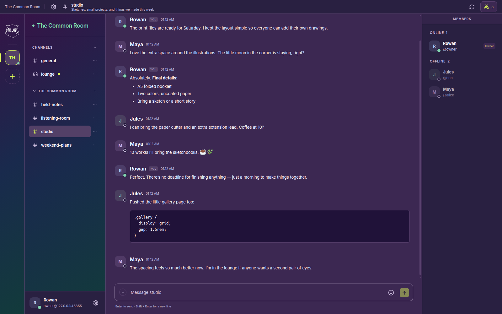

## Tidal theme with community chat and members

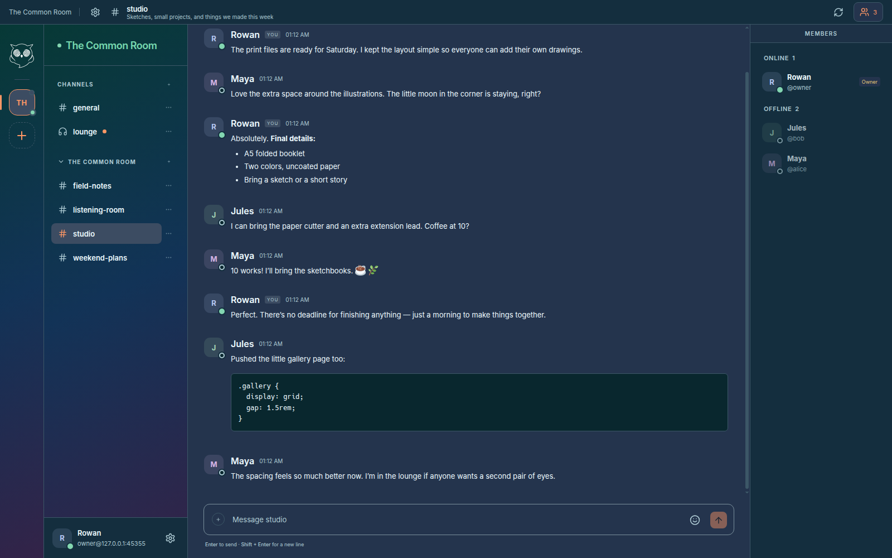

## Afterglow theme with community chat and members

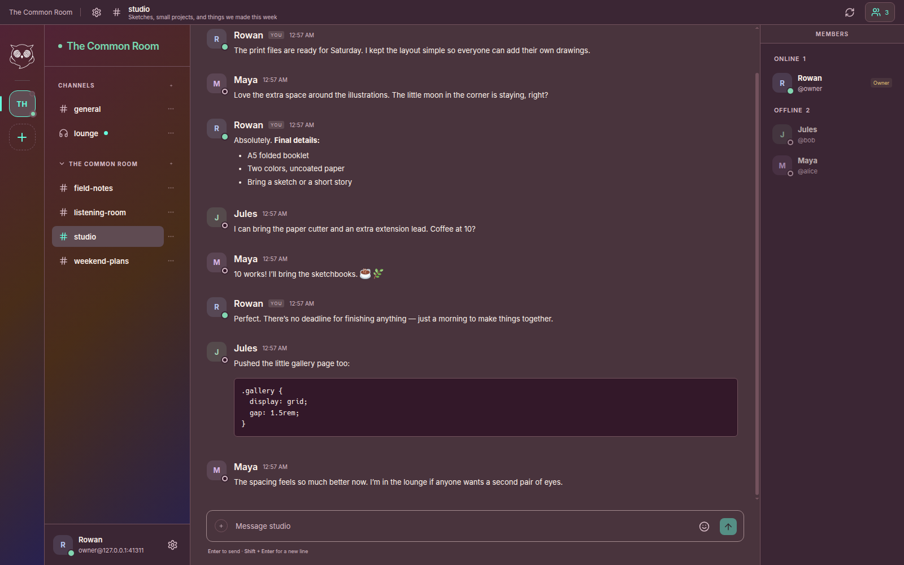

## Save, import and export named themes with editable colors

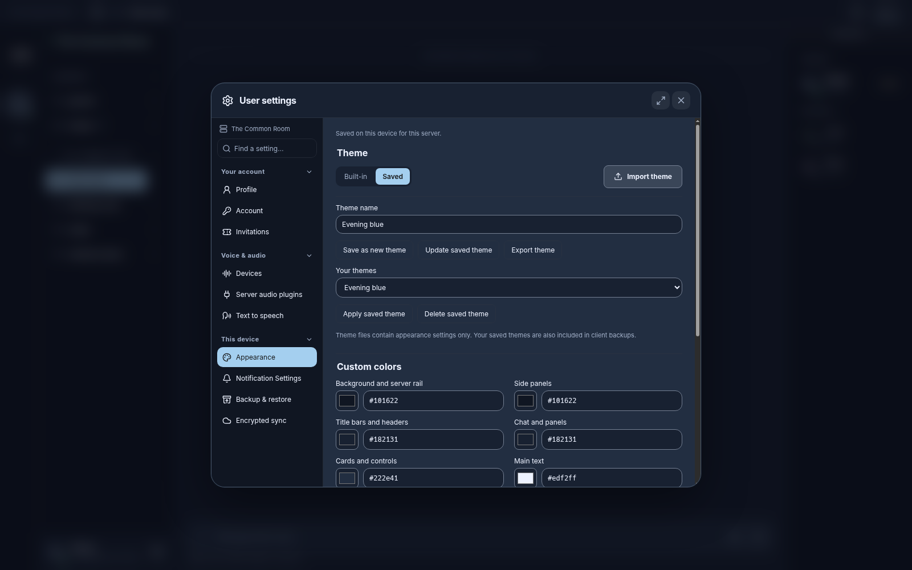

## RNNoise controls and administrator default selection

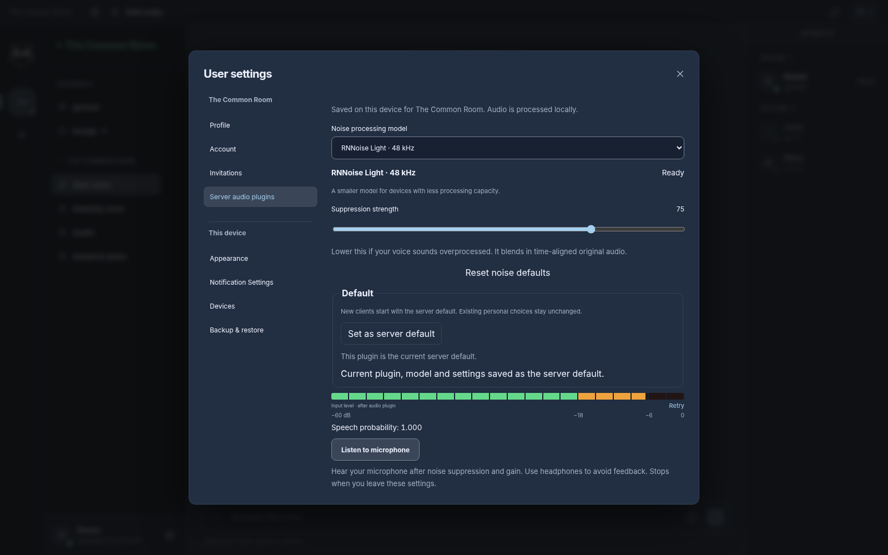

## Two participants in a real local voice call with pinned channel chat

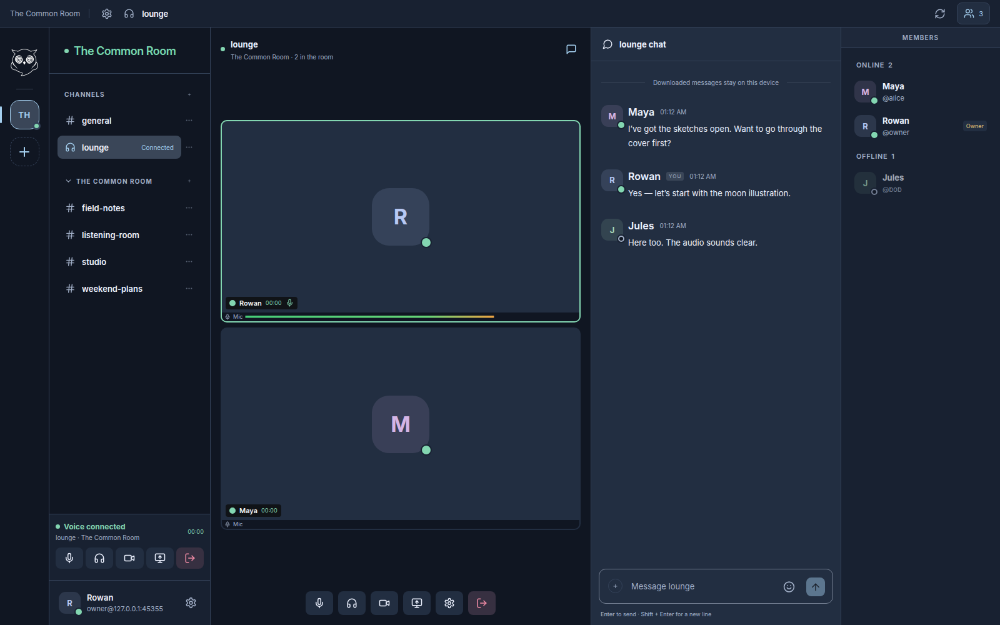

## Persistent voice controls and picture-in-picture while reading chat

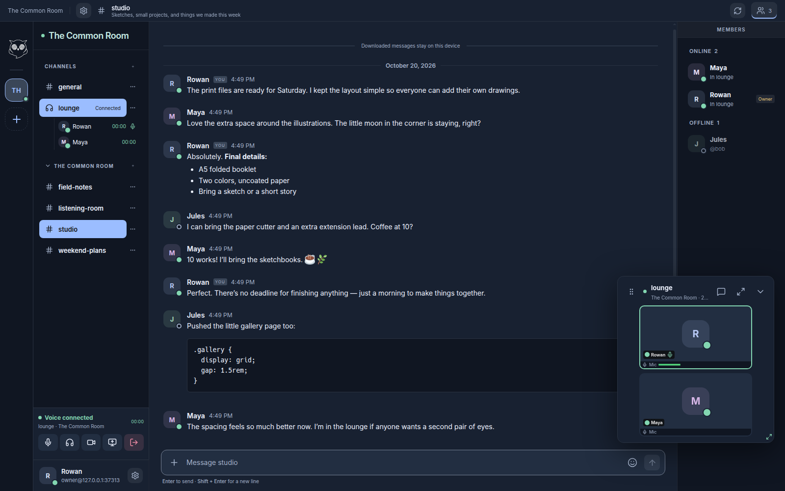

## Server-scoped member profile

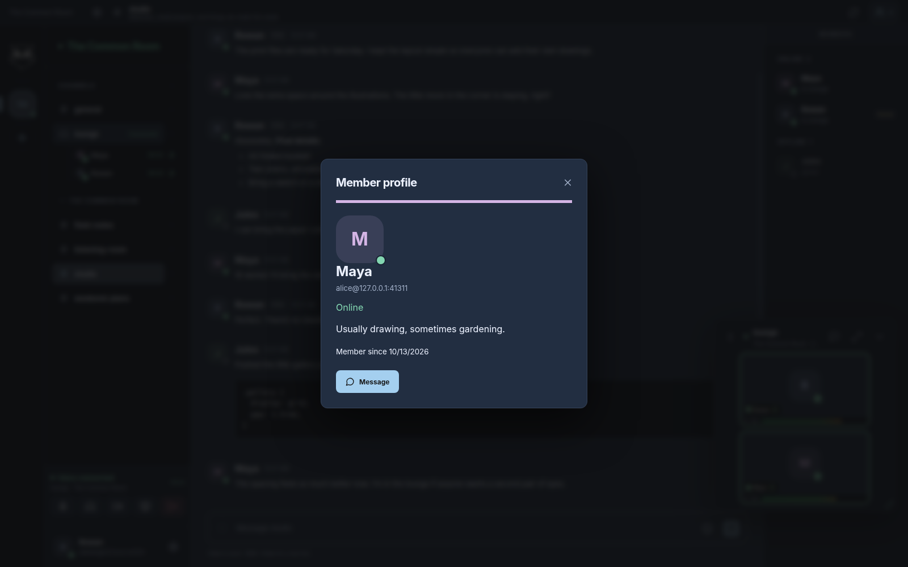
